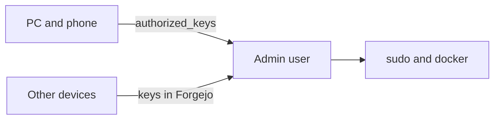

I just moved the services at home from a Raspberry Pi to a mini PC running Debian. It runs the house DNS, my Forgejo, an identity provider (Pocket ID) and a few apps of mine. With the new server I wanted to sort out something that had grown without a plan on the Pi: **who gets in over SSH, with which key, and with what permissions**.

## Every key is a root key

The underlying problem is that my admin user is in the `docker` group. That's the same as being root: anyone who can run containers can mount `/` inside one and change any file on the system. So **every key that logs in as my user is, in practice, a root key**, and it's worth knowing exactly which ones they are and where they come from.

They ended up in two places:



First things first, before any of this: SSH only accepts keys.

```
PasswordAuthentication no
PermitRootLogin no
```

## Forgejo as the key list

Forgejo, like GitHub, publishes each account's public keys at `https://<forgejo>/<user>.keys`. sshd can check that list on every connection with `AuthorizedKeysCommand`. So to add a device I just add its key in Forgejo, and to remove it I delete the key. No need to log into the server and edit files.

Since Forgejo runs on the same server, I published its web port on loopback only, so sshd doesn't depend on the proxy or DNS:

```yaml
ports:
  - '127.0.0.1:3000:3000'
```

The command sshd runs is a three-line script:

```sh
#!/bin/sh
[ "$1" = "admin" ] || exit 0
exec curl -fsS --max-time 3 http://127.0.0.1:3000/admin.keys
```

It only returns keys for my admin user; for anyone else it prints nothing. If Forgejo doesn't answer within 3 seconds, it prints nothing either, and sshd falls back to `authorized_keys`. And in the sshd config:

```
AuthorizedKeysCommand /usr/local/bin/forgejo-keys %u
AuthorizedKeysCommandUser nobody
```

Before reloading sshd, always with a second SSH session open in case something goes wrong, I validate the config:

```bash
sudo sshd -t && sudo systemctl reload ssh
```

I kept the PC and the phone in `authorized_keys`. They're my emergency way in: if Forgejo goes down, I can still get in and fix it.

### What this changes in Forgejo

Once this is in place, my Forgejo account decides who has root on the server. I did two things:

- **I checked which keys Forgejo was publishing before turning it on.** The key of the Raspberry Pi I had just retired was still there. Had I not deleted it, the old Pi would have had a shell on the new server.
- **I removed the password.** Forgejo now only accepts sign-in through Pocket ID, which uses passkeys:

```yaml
FORGEJO__service__ENABLE_INTERNAL_SIGNIN: 'false'
FORGEJO__service__ENABLE_BASIC_AUTHENTICATION: 'false'
```

The first one removes the password form from the web. The second one closes passwords on the API and git over HTTPS. Git over SSH and tokens keep working.

One important detail: with this setup, **every key on my Forgejo account works for git and also for a shell**. A device that only needs to clone doesn't get a key on my account: it uses a deploy key on the repo.

## How it ended up

- To add an admin device, I add its key in Forgejo. To remove it, I delete the key.
- The PC and the phone get in even if Forgejo is down.
- A device that only needs to clone uses a deploy key on the repo, not a key on my account.

What I liked most is that every decision came from one simple question: if someone gets hold of this key, what can they do? With that, it was easy to see where each one belonged.
