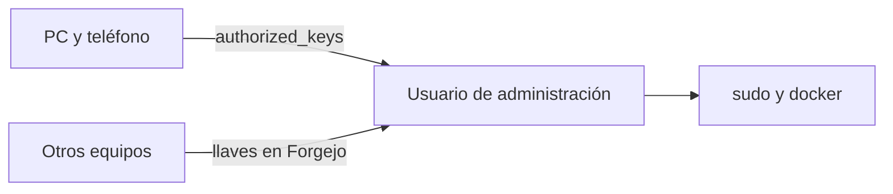

Acabo de mudar los servicios de la casa de una Raspberry Pi a una mini PC con Debian. Ahí corren el DNS de la casa, mi Forgejo, un proveedor de identidad (Pocket ID) y algunas aplicaciones mías. Con el servidor nuevo quise ordenar algo que en la Pi había crecido sin plan: **quién entra por SSH, con qué llave y con qué permisos**.

## Cada llave es de root

El problema de fondo es que mi usuario de administración está en el grupo `docker`. Eso equivale a ser root: quien puede correr contenedores puede montar `/` dentro de uno y cambiar cualquier archivo del sistema. Así que **cada llave que entra con mi usuario es, en la práctica, una llave de root**, y vale la pena saber exactamente cuáles son y de dónde salen.

Quedaron en dos lugares:



Lo primero, antes de todo esto, es que SSH solo acepte llaves:

```
PasswordAuthentication no
PermitRootLogin no
```

## Forgejo como lista de llaves

Forgejo, igual que GitHub, publica las llaves públicas de cada cuenta en `https://<forgejo>/<usuario>.keys`. sshd puede consultar esa lista en cada conexión con `AuthorizedKeysCommand`. Así, para dar de alta un equipo solo agrego su llave en Forgejo, y para darlo de baja la borro. No tengo que entrar al servidor a editar archivos.

Como Forgejo corre en el mismo servidor, publiqué su puerto web solo en loopback, para que sshd no dependa del proxy ni del DNS:

```yaml
ports:
  - '127.0.0.1:3000:3000'
```

El comando que consulta sshd es un script de tres líneas:

```sh
#!/bin/sh
[ "$1" = "admin" ] || exit 0
exec curl -fsS --max-time 3 http://127.0.0.1:3000/admin.keys
```

Solo da llaves para mi usuario de administración; para cualquier otro no imprime nada. Si Forgejo no responde en 3 segundos, tampoco imprime nada, y sshd sigue con `authorized_keys`. Y en la configuración de sshd:

```
AuthorizedKeysCommand /usr/local/bin/forgejo-keys %u
AuthorizedKeysCommandUser nobody
```

Antes de recargar sshd, siempre con otra sesión SSH abierta por si algo sale mal, valido la configuración:

```bash
sudo sshd -t && sudo systemctl reload ssh
```

Dejé la PC y el teléfono en `authorized_keys`. Son mi entrada de emergencia: si Forgejo se cae, sigo pudiendo entrar a arreglarlo.

### Lo que esto cambia en Forgejo

Al hacer esto, mi cuenta de Forgejo pasa a controlar quién tiene root en el servidor. Hice dos cosas:

- **Revisé qué llaves publicaba Forgejo antes de activarlo.** Ahí seguía la llave de la Raspberry Pi que acababa de retirar. Si no la hubiera borrado, habría quedado con shell en el servidor nuevo.
- **Quité la contraseña.** Forgejo ahora solo acepta el inicio de sesión con Pocket ID, que usa passkeys:

```yaml
FORGEJO__service__ENABLE_INTERNAL_SIGNIN: 'false'
FORGEJO__service__ENABLE_BASIC_AUTHENTICATION: 'false'
```

La primera quita el formulario de contraseña de la web. La segunda cierra la contraseña por la API y por git HTTPS. Git por SSH y los tokens siguen funcionando.

Un detalle importante: con este esquema, **cada llave de mi cuenta de Forgejo sirve para git y también para shell**. Un equipo que solo necesita clonar no lleva llave en mi cuenta: usa una deploy key del repo.

## Cómo quedó

- Para dar de alta un equipo de administración, agrego su llave en Forgejo. Para darlo de baja, la borro.
- La PC y el teléfono entran aunque Forgejo esté caído.
- Un equipo que solo necesita clonar usa una deploy key del repo, no una llave de mi cuenta.

Lo que más me gustó es que cada decisión salió de una pregunta sencilla: si alguien se queda con esta llave, ¿qué puede hacer? Con eso fue fácil ver dónde iba cada una.
